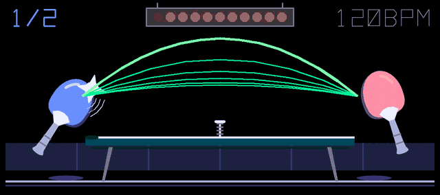
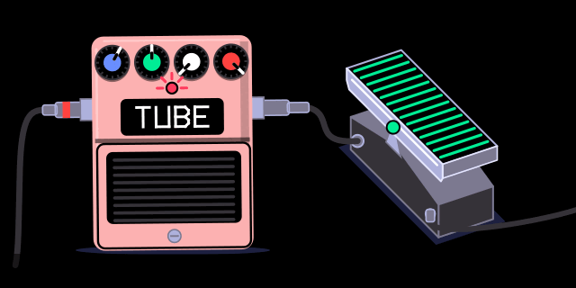
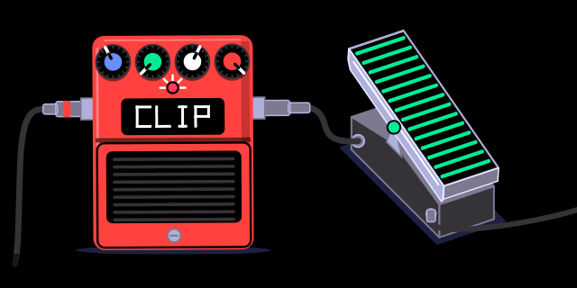

# overdub

**op1-overdub**: new synth engines, FX with animated screens, and keyboard modes for the **original OP-1 (firmware 246)**.
They are patched into TE's own firmware: every stock engine, FX and feature keeps working.
Like an overdub on tape, it adds new layers over TE's firmware without erasing anything underneath.

Not affiliated with or supported by teenage engineering. You flash this at your own risk (see [Safety](#safety)).

| | |
|---|---|
|  |  |
|  |  |

## What's in it

**Synth engines** (in the engine list with their own presets and screens)

| engine | blue | green | white | orange |
|---|---|---|---|---|
| **va**: two-oscillator virtual analog, resonant low-pass | wave (saw → square → pulse) | osc 2 detune | cutoff | resonance |
| **wavetable**: 8 banks of morphing wavetables | position | bank | warp | unison |
| **grain**: granular; plays a built-in bank, or the sample in any sampler slot | position | grain size | density | spray |

**FX** (on synth, drum and master; stereo as master FX)

| FX | blue | green | white | orange | screen |
|---|---|---|---|---|---|
| **ensemble**: Juno / string-machine chorus | rate | depth | ensemble (Solina-style vibrato) | mix | a choir |
| **pingpong**: ping-pong delay | time | feedback | tone | mix | table tennis |
| **distortion**: TUBE, MUFF, FUZZ, CLIP, FOLD, CRUSH | drive | voice (low-pass ↓, wah ↑) | character | mix | two pedals |

**Keyboard**
- **HOLD**: SHIFT + T2 on the synth screen latches released notes; again to release.
- **CHORD**: hold SHIFT and play a chord (up to 4 notes); then every key plays that shape. SHIFT + one key turns it off.

## Install

1. Download stock firmware 246 from TE: <https://teenage.engineering/_software/op-1/op1_246.op1>.
2. Download `overdub-*.zip` from [Releases](../../releases) and unzip it.
3. `python3 apply.py op1_246.op1` (Python 3.10+, no other dependencies) writes `OVERDUB.OP1`.
   It checks that your file is stock 246 and that the result is exactly the expected image.
4. On the OP-1: hold **COM** while switching on, press **1** (upload firmware), connect USB, copy `OVERDUB.OP1` to the
   OP-1 disk, eject. Same procedure as an official update.

The release contains only our code, our database rows (engine/FX names and presets) and our SVG screens.
TE's firmware never leaves your computer.

## Safety
- **The bootloader is never touched.** `te-boot.ldr` stays byte-identical to stock (the tools refuse otherwise),
  so you can always go back: hold COM at power-on, upload stock `op1_246.op1`.
- **Before going back to stock, delete sounds saved with these engines or FX.** Stock firmware doesn't know their
  names and stops at boot on such a sound. If that happens: COM at power-on, then factory reset.
- Never name a firmware file with `FRC`, `RBT` or `KEY` in it: the OP-1's updater treats those as commands.
  `apply.py` and `build.py` refuse such names.

## Build from source

Needs Docker and Python 3.10+.

```
docker build -t op1-bfin tools/docker          # ADI's bfin-elf GCC 4.3 toolchain (x86_64; runs under emulation on Apple silicon)
python3 build.py                               # everything; downloads stock 246 into firmware/stock/
python3 build.py --engines grain --fx distortion --no-hold --name MINE
```

Outputs `firmware/images/<NAME>.OP1` and the shareable `dist/overdub-<version>.zip`.
`firmware/` holds TE's firmware and anything built from it: it is gitignored, never commit or share it.
DSP is checked in the Blackfin simulator first (`src/engine/test/`, `src/slot/test/`).

## How it works

Short version: the update file has a checksum but no signature, almost all of the app is unencrypted, and the
boot ROM loads the app as a list of "copy these bytes here" blocks. We append blocks that put our code in RAM that
TE's firmware doesn't use and repoint a few of TE's tables at it. Details, with what is confirmed and what is a
hypothesis:

- [notes/firmware-format.md](notes/firmware-format.md), [notes/memory-map.md](notes/memory-map.md): image format, boot chain, update rules
- [notes/engine-interface.md](notes/engine-interface.md), [notes/engine-slot.md](notes/engine-slot.md): adding synth engines
- [notes/fx-slot.md](notes/fx-slot.md): adding FX
- [notes/screen.md](notes/screen.md), [notes/svg-route.md](notes/svg-route.md): drawing screens, animated SVGs
- [notes/hold.md](notes/hold.md), [notes/seq-chord.md](notes/seq-chord.md): keyboard hooks
- [notes/LOG.md](notes/LOG.md): every test image and its result

Everything is tied to firmware 246 (addresses change with any TE update).

## Credits
- [op1repacker](https://github.com/op1hacks/op1repacker) (op1hacks): the hidden iter engine and filter FX, and the iter
  presets our presets start from.
- [op1-decryptor](https://github.com/tabascoeye/op1-decryptor) (TabascoEye) and [op1dumps](https://github.com/Tolsi/op1dumps)
  (Tolsi): reading the encrypted part of the firmware for research. Nothing from them is needed to build or apply.
- [ghidra-blackfin](https://github.com/geepot/ghidra-blackfin): Blackfin support for Ghidra.

MIT License (see [LICENSE](LICENSE)).
